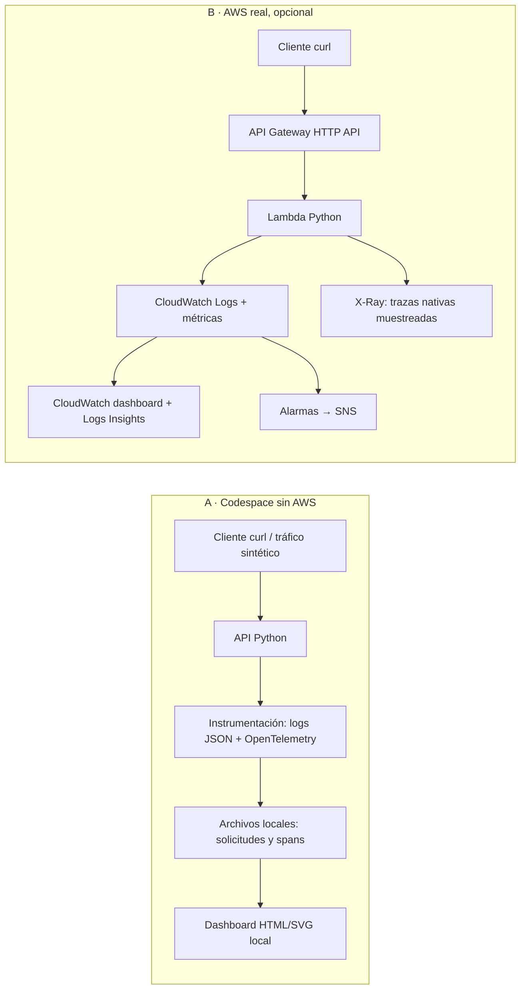
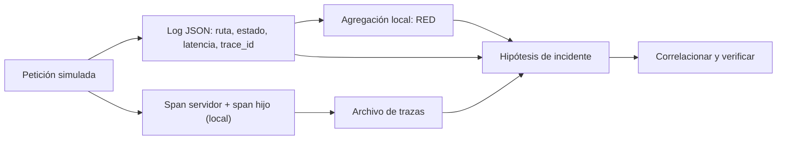
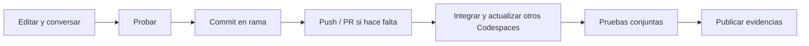

# 🔭 Laboratorio guiado — Fundamentos de Observabilidad

**UTEC Posgrado · Arquitectura de Soluciones Multinube · Módulo 8, sesión 1**
**Docente:** Aldo Trucios · **Equipos:** 3 integrantes · **Tiempo orientativo:** 60–90 min local; AWS opcional, 45–60 min adicionales.

> **Ruta garantizada:** completa las etapas 1–15 en GitHub Codespaces sin cuenta ni credenciales AWS. La [extensión AWS](#extensión-opcional-b--integración-real-con-aws) requiere una cuenta autorizada, permisos, presupuesto y tiempo adicionales. La CLI instalada **no proporciona credenciales ni acceso**.

## 1. Introducción, objetivos y arquitectura

**Objetivo.** Diferenciar *monitoring* —vigilar indicadores y umbrales conocidos— de *observabilidad*: investigar preguntas no previstas a partir de las señales disponibles. Aplicar RED (Rate, Errors, Duration) y razonar sobre USE (Utilization, Saturation, Errors).

**Acción.** El equipo recorrerá toda la guía, generará tráfico sintético, correlacionará señales y presentará una hipótesis sustentada. Localmente los datos de pagos, demoras y errores son **simulados**; no hay datos bancarios ni servicios AWS simulados.





**Resultado esperado / verificación.** Identifiquen dónde se generan, almacenan y consultan los logs, métricas y trazas en cada modalidad. **Problemas:** si no conocen un término, regresen al diagrama después de ejecutar la etapa correspondiente. **Interpretación:** el dashboard local calcula agregados desde logs; CloudWatch y X-Ray son servicios reales y separados, no equivalentes locales.

## 2. Organización del grupo y colaboración

**Objetivo.** Que los tres comprendan el recorrido completo y entreguen un resultado integrado.

**Acción.** Elijan trabajar juntos compartiendo pantalla o distribuir tareas y reunirse para integrar y validar. Roles opcionales: desarrollo/instrumentación, análisis de telemetría y validación SRE. **Todos siguen el paso a paso, discuten las decisiones y verifican el resultado final.**

1. Abran el repositorio de la clase en GitHub. Si tienen escritura, acuerden una rama de equipo. Si no, una persona hace **Fork** desde GitHub y comparte el enlace; configure el acceso de sus compañeros mediante **Settings → Collaborators**, si su organización lo permite. Sin permisos de invitación, solicítenlos al docente.
2. Pueden usar **un mismo Codespace por turnos** con pantalla compartida, o un Codespace por persona. Un Codespace no es una carpeta sincronizada en tiempo real con otro: compartan código mediante commits, `push`, `fetch` y `pull`, o una pull request (PR).
3. Decidan quién integra. Usen una rama por equipo; si editan simultáneamente, creen ramas individuales a partir de la rama del equipo y abran PR hacia ella. Eviten modificar la misma línea sin coordinar.



**Comandos.** En el Codespace del repositorio compartido:

```bash
git status
git switch -c equipo-01  # elijan un nombre único; si ya existe, cambien a él
```

Si la rama ya está publicada y trabajan desde otro Codespace:

```bash
git fetch origin
git switch --track origin/equipo-01
git pull --ff-only
```

**Resultado esperado / verificación.** `git status` muestra la rama acordada. **Problemas:** si `switch -c` indica que ya existe, usen `git switch equipo-01`; si `push` falla por permisos, trabajen en un fork compartido. **Interpretación:** `commit` es local; solo `push` publica y los demás deben recuperar esos cambios. Las PR no son obligatorias si el grupo trabaja en una sola rama sin conflictos.

## 3. Preparación del Codespace

**Objetivo.** Usar un entorno reproducible sin instalaciones en la computadora personal.

**Acción.**

1. En GitHub abran el repositorio compartido o su fork y la rama acordada.
2. Pulsen **Code → Codespaces → Create codespace on [rama]**.
3. Esperen a que termine la creación y el `postCreateCommand`; consulten el registro de creación si aparece un error. El devcontainer instala Python 3.11, AWS CLI v2, Git, zip, curl y las dependencias de `requirements.txt`.
4. Abran **Terminal → New Terminal**. Si no están en la raíz, ejecuten `cd /workspaces/m04-sre-s01` o usen `pwd` y `ls` para ubicar la carpeta que contiene `guiado.md`.

**Resultado esperado / verificación.** Hay una terminal en la raíz y el puerto 8000 figura como privado cuando se inicie la aplicación. **Problemas:** si falla la preparación, revisen el log del contenedor, conexión y cuota de Codespaces; desde la paleta de comandos prueben **Codespaces: Rebuild Container**. No configuren secretos en archivos versionados. **Interpretación:** el contenedor define herramientas comunes; crear un Codespace no inicia sesión en AWS.

## 4. Verificación del entorno y dependencias

**Objetivo.** Confirmar versiones y ejecutar pruebas antes de generar datos.

**Acción y comandos.**

```bash
python --version
aws --version
git --version
zip -v | head -n 2
curl --version | head -n 1
python -m pip check
python -m pytest -q
```

**Resultado esperado.** Python 3.11, `aws-cli/2`, herramientas disponibles, `No broken requirements found` y pruebas aprobadas. Si la instalación automática falló, ejecuten `python -m pip install -r requirements.txt` y repitan.

**Verificación / problemas.** `python -c 'import opentelemetry.sdk.trace, pytest; print("dependencias OK")'`. Si no encuentra `aws`, reconstruyan el devcontainer; la ruta local no necesita AWS CLI. Si pytest falla, lean el error antes de avanzar. **Interpretación:** OpenTelemetry registra spans localmente; no requiere collector, backend remoto ni credenciales.

## 5. Ejecución de la aplicación

**Objetivo.** Iniciar una API mínima accesible solo mediante el puerto privado del Codespace.

**Acción.** En la primera terminal, desde la raíz:

```bash
python -m lab.app
```

Déjenla abierta. En una segunda terminal:

```bash
curl -i http://127.0.0.1:8000/health
curl -i -X POST http://127.0.0.1:8000/pay -H 'Content-Type: application/json' -d '{"amount":100}'
```

**Resultado esperado.** HTTP 200 y JSON `{"status": "ok"}` o `{"status": "paid", "simulated": true}`. El importe es ilustrativo; no se procesa ni persiste información de pago.

**Verificación / problemas.** Si `curl` no conecta, comprueben que el servidor sigue activo y que están en el mismo Codespace. Si el puerto está ocupado, detengan su proceso anterior con `Ctrl+C`; no maten procesos ajenos. **Interpretación:** `/health` muestra disponibilidad de la ruta, no demuestra que todas las dependencias funcionen.

## 6. Instrumentación y generación de telemetría

**Objetivo.** Examinar logs estructurados, spans y correlación.

**Acción.** Lean `lab/app.py`: cada petición crea un span servidor, un `request_id`, un `trace_id` y un log JSON; `/pay` y `/slow` crean un span hijo. `lab/dashboard.py` agrega logs para construir métricas; no existe un servidor Prometheus.

```bash
tail -n 2 data/requests.jsonl
tail -n 4 data/traces.jsonl
```

**Resultado esperado / verificación.** Cada línea es JSON. Comparen el `trace_id` de un log con el de sus spans; el hijo tiene `parent_span_id` igual al `span_id` del servidor. **Problemas:** si falta un archivo, generen otra petición y esperen un instante: el span se exporta al terminar. **Interpretación:** logs aportan contexto por evento; métricas resumen conjuntos; trazas describen relaciones temporales. No envíen datos personales, tokens ni contenido real de pagos.

## 7. Generación controlada de tráfico y errores

**Objetivo.** Producir una mezcla conocida de respuestas exitosas, lentas y fallidas.

**Acción.**

```bash
python -m lab.traffic --cycles 5
curl -i http://127.0.0.1:8000/error
curl -i http://127.0.0.1:8000/slow
```

**Resultado esperado.** El script añade 25 solicitudes: por ciclo, una `/health`, dos `/pay`, una `/slow` y una `/error`; devuelve un resumen JSON con 20 respuestas 200 y 5 respuestas 500. Los `curl` añaden otras dos. El error HTTP 500 es **intencional**, no un fallo del script; `/slow` tarda aproximadamente 800 ms.

**Verificación / problemas.** Si aparece `No se pudo conectar`, inicien el servidor en la primera terminal; `--cycles` debe ser positivo. **Interpretación:** son cargas sintéticas secuenciales, no una prueba real de capacidad ni una estimación de producción.

## 8. Exploración de logs

**Objetivo.** Investigar eventos individuales sin herramientas ni servicios externos.

**Acción.** Consulten errores y sus identificadores:

```bash
python - <<'PY'
import json
with open("data/requests.jsonl", encoding="utf-8") as f:
    for line in f:
        r = json.loads(line)
        if r["status"] >= 500:
            print(r["timestamp"], r["path"], r["status"], r["trace_id"])
PY
```

**Resultado esperado / verificación.** Aparecen entradas de `/error` con estado 500 y `trace_id`. Abran el archivo y confirmen los campos `request_id`, `latency_ms`, `method` y `simulated`. **Problemas:** si no existen datos, completen las etapas 5 y 7. **Interpretación:** un evento concreto puede explicar un síntoma; no revela por sí solo la proporción de errores. Los archivos locales se acumulan hasta que los eliminen.

## 9. Análisis de métricas y consultas

**Objetivo.** Medir RED y entender cómo se obtienen las cifras.

**Acción.**

```bash
python - <<'PY'
from lab.dashboard import load_records, summarize
r = load_records("data")
print("RED:", summarize(r))
for path in sorted({x["path"] for x in r}):
    print(path, summarize([x for x in r if x["path"] == path]))
PY
```

**Resultado esperado / verificación.** Verán `requests`, `errors` (solo HTTP 5xx), `error_rate` en porcentaje y p50/p90/p99 en milisegundos. Por ruta, `/slow` debe ser más lento que `/pay`; el denominador global incluye todas las rutas registradas, incluidos 404. La tabla por minuto del dashboard muestra **conteos por minuto UTC**, no solicitudes por segundo: dividan por 60 para una tasa media por segundo.

**Problemas.** Sin datos los percentiles aparecen como `None`; generen tráfico. **Interpretación.** p50/p90/p99 son percentiles por rango más próximo; con pocas muestras son inestables, pueden coincidir con el máximo y no representan un SLO. La aplicación mide duración desde el inicio del handler hasta antes de enviar la respuesta; no incluye toda la latencia de red. Métricas de aplicación y de plataforma responden preguntas diferentes. Eviten usar `request_id`, `trace_id` o IDs de usuario como dimensiones de métricas: su cardinalidad y costo crecerían sin límite.

## 10. Exploración de trazas

**Objetivo.** Entender spans y propagación de contexto W3C.

**Acción.** Simulen una petición desde un servicio anterior, con un `traceparent` fijo:

```bash
curl -i -X POST http://127.0.0.1:8000/pay \
  -H 'traceparent: 00-1234567890abcdef1234567890abcdef-1234567890abcdef-01'
python - <<'PY'
import json
with open("data/traces.jsonl", encoding="utf-8") as f:
    for line in f:
        s = json.loads(line)
        if s["trace_id"] == "1234567890abcdef1234567890abcdef":
            print(s["name"], "span:", s["span_id"], "padre:", s["parent_span_id"])
PY
```

**Resultado esperado / verificación.** El span `POST /pay` conserva el trace ID y tiene como padre `1234567890abcdef`; `payment.check` es hijo del span servidor. Busquen ese mismo trace ID en `data/requests.jsonl`.

**Problemas.** Si solo aparece el hijo, esperen a que termine la petición y repitan la lectura. **Interpretación.** El encabezado representa un padre remoto **simulado**: no hay un segundo servicio real. La propagación permite relacionar spans de servicios distintos si ambos están instrumentados; aquí solo se ejecuta uno. Cada solicitud del script normal genera una traza independiente.

## 11. Creación e interpretación de gráficos o dashboards

**Objetivo.** Visualizar tráfico, errores y latencia sin desplegar una pila adicional.

**Acción.** Con el servidor activo, abran la pestaña **Ports/Puertos** de Codespaces, busquen el puerto privado `8000`, pulsen **Open in Browser** y agreguen `/dashboard` a la URL. También pueden comprobar desde terminal:

```bash
curl -s http://127.0.0.1:8000/dashboard | grep -o 'Solicitudes por minuto UTC'
```

**Resultado esperado / verificación.** El dashboard presenta número de solicitudes, porcentaje de 5xx, p50/p90/p99, barras de solicitudes y tasa 5xx por minuto UTC, percentiles globales y latencia media por ruta. Refresquen el navegador tras generar más tráfico; `/slow` debería mostrar una barra mayor. Los gráficos se generan a partir de los datos **simulados realmente registrados**, no son imágenes predefinidas. Las barras se escalan respecto al máximo de cada gráfico; lean sus valores antes de comparar.

**Problemas.** Si hay página vacía, revisen el servidor y generen solicitudes. Si el navegador no abre, verifiquen el puerto 8000 privado en la pestaña Ports; no lo hagan público. **Interpretación.** Un gráfico temporal resume tráfico; la distribución por ruta ayuda a localizar la latencia, pero no identifica por sí sola la causa.

## 12. Diagnóstico de un incidente

**Objetivo.** Formular y contrastar una hipótesis, no solo mirar indicadores.

**Acción.** Escenario: «aumentaron los errores y algunos clientes perciben lentitud». En equipo:

1. Usen dashboard y consulta RED para describir alcance, periodo, porcentaje de 5xx y p99; anoten número de muestras.
2. Filtren logs y anoten un `trace_id` de `/error`; revisen su span. Comparen con una traza de `/slow` y su hijo `payment.slow_dependency`.
3. Formulen dos hipótesis: ¿el error forzado explica la lentitud? ¿la dependencia lenta explica los 500? Comprueben estados y duraciones por ruta. Documenten que ambos síntomas fueron introducidos por rutas simuladas independientes.
4. Propongan una alerta accionable: por ejemplo, 5xx por encima del umbral acordado con volumen mínimo y ventana sostenida; especifiquen responsable, acción y enlace al runbook.

**Resultado esperado / verificación.** Una conclusión basada en al menos un indicador, un log y una traza, con sus límites. **Problemas:** si no hay spans de `/slow`, repitan `curl /slow`; no asuman causalidad por coincidencia temporal. **Interpretación:** alertar por cada evento aislado genera fatiga; umbrales, volumen mínimo, ventana y SLO deberían adaptarse al servicio real.

**USE.** En este laboratorio local no se recolectan CPU, memoria ni colas: no inventen porcentajes de utilización o saturación. En AWS, concurrencia respecto de límites y throttles ayudan a investigar saturación; `Duration` no mide CPU ni memoria. La memoria máxima reportada por Lambda frente a la memoria configurada es una señal de memoria por invocación, no utilización de CPU. Serverless abstrae infraestructura y no expone todas las señales USE.

## 13. Publicación del código y las evidencias en GitHub

**Objetivo.** Compartir un resultado reproducible, sin secretos ni datos reales.

**Acción.** Como equipo creen una evidencia breve versionable:

```bash
mkdir -p evidencias
cat > evidencias/equipo-01.md <<'EOF'
# Evidencia del equipo

- Integrantes: [completar]
- Modalidad: local (datos simulados)
- Solicitudes y ventana observada: [completar]
- Tasa 5xx y p50/p90/p99, con número de muestras: [completar]
- Hipótesis, log y trace_id que la sustentan: [completar]
- Conclusión, limitaciones y alerta propuesta: [completar]
EOF
```

Completen el archivo y, si desean, adjunten una captura del dashboard al documento o PR usando la interfaz de GitHub. No publiquen credenciales, correos, ARN de cuenta, datos personales ni URL AWS pública. `data/` está ignorado: copien solo datos sintéticos revisados si deciden incluirlos; el código y los comandos reproducen las consultas y gráficos.

```bash
git status
git diff
git add evidencias/equipo-01.md
git commit -m "Añadir evidencia de observabilidad del equipo"
git push -u origin equipo-01
```

Si también cambiaron código o consultas, revisen `git diff` y añadan **esos archivos explícitamente** con `git add ruta`. Si usan ramas individuales, abran una PR hacia la rama de equipo, revísenla, integren y en los otros Codespaces ejecuten `git fetch origin` y `git pull --ff-only` desde la rama de equipo. Después ejecuten `python -m pytest -q` y repitan una solicitud y el dashboard.

**Resultado esperado / verificación.** El archivo aparece en la rama remota y los tres pueden verlo; el equipo valida el resultado integrado. **Problemas:** si la rama remota avanzó, integren los cambios mediante una PR o consulten el conflicto antes de volver a publicar; no sobrescriban trabajo ajeno. **Interpretación:** publicar un commit no sincroniza automáticamente los archivos de los demás Codespaces.

## 14. Limpieza y cierre del laboratorio

**Objetivo.** Evitar procesos, datos y costos residuales.

**Acción.** Detengan el servidor con `Ctrl+C` en su terminal. Si desean eliminar únicamente los datos locales generados:

```bash
rm -f data/requests.jsonl data/traces.jsonl
```

En GitHub: **Code → Codespaces**, seleccionen su Codespace y **Stop codespace**. Cuando ya no lo necesiten, elimínenlo desde el menú correspondiente; detenerlo no necesariamente elimina el almacenamiento facturable. Si usaron AWS, completen primero la limpieza de la extensión.

**Resultado esperado / verificación.** El servidor terminó y el Codespace está detenido; el código y las evidencias ya están publicados. **Problemas:** si perdieron la terminal del servidor, localicen su proceso en el Codespace antes de detenerlo; no afecten procesos ajenos. **Interpretación:** eliminar archivos locales no borra el historial Git ni los recursos de AWS.

## 15. Preguntas de reflexión y reto final

**Objetivo.** Explicar decisiones y límites con evidencia.

**Acción.** Respondan en equipo y añadan las respuestas a su evidencia:

1. ¿Qué pregunta nueva pudieron responder correlacionando logs, métricas y trazas que no respondía un único indicador?
2. ¿Cómo cambian RED y USE entre el proceso local y Lambda? ¿Por qué duración no equivale a memoria o CPU?
3. ¿Qué diferencias hay entre un 500 controlado y una excepción no capturada? ¿Cuál afectaría a `AWS/Lambda Errors`?
4. ¿Qué ocurriría con costo y utilidad si cada usuario fuera una dimensión? ¿Qué datos sensibles deben excluirse de logs y trazas?
5. ¿Cuándo un p99 con pocas muestras es engañoso? ¿Cómo elegirían volumen mínimo, periodo y acción de una alerta?
6. ¿Qué pierden al muestrear trazas? ¿Qué costo tienen retención, consultas, métricas y dashboards?

**Reto.** Agreguen una consulta por intervalo o una ruta simulada, escriban una prueba y documenten su interpretación. Si tienen AWS autorizado, amplíen la ruta real sin poner información sensible en métricas.

**Resultado esperado / verificación.** Evidencia publicada, explicación compartida por los tres y pruebas aprobadas. **Problemas:** vuelvan a las etapas 8–12 y distingan hechos observados de hipótesis. **Interpretación:** la observabilidad orienta la investigación; no garantiza que toda causa sea visible.

---

# Extensión opcional B — integración real con AWS

> Realicen esta sección **antes de la limpieza final** y solo con autorización del docente. La API será pública y no tendrá autenticación: utilicen exclusivamente datos sintéticos, no compartan su URL y eliminen el stack al terminar. Lambda, API Gateway, CloudWatch, métricas personalizadas, X-Ray, SNS y Codespaces pueden generar costos; límites gratuitos y presupuestos dependen de la cuenta. No es necesaria para completar la modalidad A.

## B1. Permisos, identidad y región

**Objetivo.** Separar los permisos del operador de los de la función.

**Acción.** Pidan al administrador una cuenta/rol temporal y una región permitida. El operador necesita, según la política de la organización, acceso a CloudFormation (crear/actualizar/describir/eliminar stack), IAM (crear y borrar el rol y su política, `iam:PassRole` limitado al rol Lambda), Lambda (crear/configurar/eliminar e invocar, permisos de recurso), API Gateway v2, CloudWatch Logs (grupos/filtros/consultas), CloudWatch (métricas/alarmas/dashboard), SNS (topic/suscripción) y X-Ray (lectura). CloudFormation puede operar con un rol de servicio autorizado por el administrador. No se requieren permisos administrativos generales; las políticas efectivas, límites y SCP pueden impedir operaciones.

El **rol de ejecución Lambda** creado por la plantilla solo permite escribir en su grupo de logs, publicar métricas en su namespace y enviar telemetría X-Ray; no necesita publicar a SNS ni crear infraestructura. Alarmas CloudWatch notifican a SNS.

Para acceso con IAM Identity Center, si la organización lo proporciona:

```bash
aws configure sso
aws sso login --profile NOMBRE_PERFIL
export AWS_PROFILE=NOMBRE_PERFIL
export AWS_REGION=us-east-1  # cambien a la región autorizada
export AWS_DEFAULT_REGION="$AWS_REGION"
aws sts get-caller-identity
```

Usen el mecanismo temporal aprobado por su organización si no dispone de SSO. Nunca peguen claves en el repositorio, plantilla, scripts, capturas ni PR. No ejecuten `aws configure` con claves permanentes compartidas.

**Resultado esperado / verificación.** STS devuelve la identidad y cuenta esperadas en la región elegida. No publiquen esa salida. **Problemas:** `Unable to locate credentials` significa que la CLI no tiene sesión; `AccessDenied` requiere autorización, no un intento de elevar permisos. Sin acceso, terminen la modalidad local. **Interpretación:** instalar AWS CLI no otorga identidad ni permisos.

## B2. Despliegue aislado

**Objetivo.** Crear y eliminar el conjunto coherente como un stack.

**Acción.** Acuerden un identificador único por equipo y ejecuten desde la raíz:

```bash
export TEAM_ID=equipo-01  # minúsculas, números o guiones; único en cuenta y región
export STACK_NAME="obs-${TEAM_ID}"
aws cloudformation deploy \
  --template-file aws/template.yaml \
  --stack-name "$STACK_NAME" \
  --parameter-overrides TeamId="$TEAM_ID" \
  --capabilities CAPABILITY_IAM \
  --region "$AWS_REGION"
aws cloudformation describe-stacks --stack-name "$STACK_NAME" --region "$AWS_REGION" \
  --query 'Stacks[0].Outputs' --output table
```

```bash
export API_URL="$(aws cloudformation describe-stacks --stack-name "$STACK_NAME" --region "$AWS_REGION" --query "Stacks[0].Outputs[?OutputKey=='ApiUrl'].OutputValue | [0]" --output text)"
export LOG_GROUP="$(aws cloudformation describe-stacks --stack-name "$STACK_NAME" --region "$AWS_REGION" --query "Stacks[0].Outputs[?OutputKey=='LogGroupName'].OutputValue | [0]" --output text)"
export LAMBDA_NAME="$(aws cloudformation describe-stacks --stack-name "$STACK_NAME" --region "$AWS_REGION" --query "Stacks[0].Outputs[?OutputKey=='FunctionName'].OutputValue | [0]" --output text)"
export SNS_ARN="$(aws cloudformation describe-stacks --stack-name "$STACK_NAME" --region "$AWS_REGION" --query "Stacks[0].Outputs[?OutputKey=='TopicArn'].OutputValue | [0]" --output text)"
printf 'Lambda: %s\nLog group: %s\n' "$LAMBDA_NAME" "$LOG_GROUP"
```

**Resultado esperado.** Stack `CREATE_COMPLETE`; Lambda `payment-lambda-equipo-01`, API `payment-api-equipo-01`, log group `/aws/lambda/payment-lambda-equipo-01`, namespace `LabObservabilidad/equipo-01`, topic `alertas-obs-equipo-01` y dashboard `observabilidad-equipo-01`. La plantilla fija retención de logs de 7 días.

**Verificación / problemas.** Consulten eventos con `aws cloudformation describe-stack-events --stack-name "$STACK_NAME" --region "$AWS_REGION" --max-items 20`. Colisión de nombres: elijan otro `TEAM_ID`; permisos o cuotas: consulten al administrador. Un despliegue fallido puede dejar un stack en rollback: revisen eventos y elimínenlo en B7. No continúen con variables vacías. **Interpretación:** CloudFormation administra el ciclo de vida; las métricas y trazas históricas tienen retención propia.

## B3. Tráfico y diferencias entre errores

**Objetivo.** Distinguir respuestas de aplicación y fallos de ejecución Lambda.

**Acción.**

```bash
curl -i "${API_URL}/health"
curl -i -X POST "${API_URL}/pay" -H 'Content-Type: application/json' -d '{"amount":100}'
python -m lab.traffic --url "$API_URL" --cycles 5
curl -i "${API_URL}/error"
```

La ruta `/error` devuelve 500 **controlado**: Lambda finaliza normalmente y publica `Http5xx`; esto no incrementa necesariamente `AWS/Lambda Errors`. Para observar una excepción no capturada, invóquenla directamente y comparen:

```bash
mkdir -p build
aws lambda invoke --function-name "$LAMBDA_NAME" --region "$AWS_REGION" \
  --cli-binary-format raw-in-base64-out \
  --payload '{"rawPath":"/error","requestContext":{"http":{"method":"GET"}}}' \
  --query FunctionError --output text build/controlled.json
cat build/controlled.json
aws lambda invoke --function-name "$LAMBDA_NAME" --region "$AWS_REGION" \
  --cli-binary-format raw-in-base64-out \
  --payload '{"rawPath":"/exception","requestContext":{"http":{"method":"GET"}}}' \
  --query FunctionError --output text build/exception.json
cat build/exception.json
```

**Resultado esperado / verificación.** En la primera invocación `FunctionError` es `None` y el cuerpo contiene `statusCode: 500`; en la segunda aparece `Unhandled` y el cuerpo describe la excepción. `AWS/Lambda Errors` cuenta la excepción, no el 500 controlado. API Gateway normalmente devuelve 502 ante ese fallo de integración; la ruta `/exception` existe solo para esta prueba.

**Problemas.** Si `curl` no conecta, revisen salidas del stack, región y stage; ante 403/5xx inesperados consulten Logs. La publicación de métricas puede tardar varios minutos; revisen eventos `metric_publish_failed` si faltan. **Interpretación:** un código HTTP y el resultado de ejecución de Lambda son señales diferentes. La latencia custom mide tiempo del handler antes de publicar la métrica; `AWS/Lambda Duration` incluye más trabajo y no equivale a latencia extremo a extremo.

## B4. Logs, métricas y X-Ray

**Objetivo.** Consultar señales nativas y personalizadas.

**Acción.** En AWS Console, seleccionen la misma región → **CloudWatch → Logs Insights**, elijan el grupo mostrado en `LOG_GROUP`, un intervalo que incluya las pruebas y ejecuten:

```sql
fields @timestamp, event_type, path, status, latency_ms, request_id, xray_trace
| filter event_type = "request" and status >= 500
| sort @timestamp desc
| limit 25
```

```sql
fields path, status, latency_ms
| filter event_type = "request"
| stats count(*) as requests, sum(status >= 500) as errors,
        pct(latency_ms, 50) as p50, pct(latency_ms, 90) as p90,
        pct(latency_ms, 99) as p99 by path
```

Si su versión de Logs Insights no admite la expresión booleana en `sum`, usen `filter status >= 500 | stats count(*) as errors by path` como consulta separada. El filtro `Http5xxFromLogs` cuenta eventos posteriores a su creación y no reconstruye el pasado; la métrica directa `Http5xx` usa dimensión `AppName`, mientras el filtro no tiene dimensión. No las sumen: representan los mismos eventos por caminos distintos.

Para señales de plataforma consulten los eventos `REPORT` y sus campos `@duration`, `@memorySize` y `@maxMemoryUsed` cuando estén disponibles:

```sql
filter @type = "REPORT"
| stats avg(@duration) as avg_ms, max(@maxMemoryUsed) as max_mem_bytes,
        max(@memorySize) as configured_mem_bytes
```

En **CloudWatch → X-Ray traces**, seleccionen el intervalo y una traza Lambda. El tracing activo de Lambda es **muestreado**: no todas las peticiones aparecen. El campo `xray_trace` del log ayuda a correlacionar cuando hay una traza muestreada. La plantilla usa integración X-Ray nativa, no instala el SDK X-Ray ni instrumenta subsegmentos de aplicación o llamadas boto3; no esperen el span local `payment.check` ni un nodo CloudWatch en el mapa.

**Resultado esperado / verificación.** Logs JSON con rutas y estados; métricas `RequestLatency` y `Http5xx` en `LabObservabilidad/${TEAM_ID}`; si hay muestreo, trazas Lambda. **Problemas:** amplíen intervalo y esperen ingesta; generen más tráfico si X-Ray no muestra trazas. Las métricas sin eventos pueden no existir aún. **Interpretación:** los `REPORT` de plataforma complementan el tiempo medido por la aplicación; memoria máxima no es CPU ni costo calculado.

## B5. Alarmas, SNS y dashboard

**Objetivo.** Relacionar indicadores con alertas y acciones.

**Acción.** El stack crea alarmas `Http5xx-${TEAM_ID}` (≥3 en 60 s), `Latency-p99-${TEAM_ID}` (≥700 ms en 60 s), `LambdaErrors-${TEAM_ID}` (≥1 en 60 s) y `LambdaThrottles-${TEAM_ID}` (≥1 en 60 s), todas con datos ausentes tratados como no infractores. Umbrales didácticos, no recomendación de producción.

Opcionalmente suscriban una dirección autorizada **sin guardarla en Git**:

```bash
read -r -p "Correo para SNS: " EMAIL_ALERTA
aws sns subscribe --topic-arn "$SNS_ARN" --protocol email \
  --notification-endpoint "$EMAIL_ALERTA" --region "$AWS_REGION"
unset EMAIL_ALERTA
```

Confirmen el enlace recibido; sin confirmación no llegan mensajes. Generen al menos tres `/error` dentro de un minuto:

```bash
for i in 1 2 3 4; do curl -s -o /dev/null "${API_URL}/error"; done
aws cloudwatch describe-alarms --region "$AWS_REGION" \
  --alarm-names "Http5xx-${TEAM_ID}" "Latency-p99-${TEAM_ID}" \
    "LambdaErrors-${TEAM_ID}" "LambdaThrottles-${TEAM_ID}" \
  --query 'MetricAlarms[*].[AlarmName,StateValue]' --output table
```

En **CloudWatch → Dashboards**, abran `observabilidad-${TEAM_ID}`: invocaciones, 5xx frente a errores Lambda, percentiles de latencia de aplicación, throttles y concurrencia máxima.

**Resultado esperado / verificación.** Tras la ingesta y evaluación, la alarma HTTP puede pasar a `ALARM`; el correo solo llega tras confirmación y un cambio de estado. La alarma Lambda se relaciona con `/exception`, no con `/error`. **Problemas:** esperen varios minutos y revisen región, periodo, dimensión `AppName`, suscripción y estado; una alarma ya en `ALARM` no envía otra notificación por cada evento. **Interpretación:** con pocas muestras p99 es poco robusto; `notBreaching` puede ocultar ausencia de telemetría. En producción definan volumen mínimo, periodos y runbook.

## B6. Evidencia y costos

**Objetivo.** Registrar resultados sin exponer la cuenta.

**Acción.** Añadan a su evidencia modalidad, periodo, conteos, consulta, observaciones y límites del muestreo. Oculten cuenta, ARN, URL pública, correo y credenciales en capturas. Consulten presupuestos y precios vigentes: logs ingeridos/almacenados y consultas, métricas y dimensiones, alarmas, dashboards, peticiones, trazas y duración pueden costar dinero.

**Resultado esperado / verificación.** Un compañero puede explicar cómo se obtuvo cada cifra sin acceder a secretos. **Problemas:** si no hay métricas o trazas, documenten la ausencia y su causa probable, no inventen resultados. **Interpretación:** más retención, más cardinalidad y más muestreo aumentan visibilidad y costo.

## B7. Limpieza AWS

**Objetivo.** Eliminar los recursos del equipo y comprobarlo.

**Acción.** Comprueben cuenta, región y nombre antes de borrar:

```bash
aws sts get-caller-identity
printf 'Región: %s · stack: %s\n' "$AWS_REGION" "$STACK_NAME"
aws cloudformation delete-stack --stack-name "$STACK_NAME" --region "$AWS_REGION"
aws cloudformation wait stack-delete-complete --stack-name "$STACK_NAME" --region "$AWS_REGION"
```

**Resultado esperado / verificación.** El stack desaparece de CloudFormation; revisen en consola que desaparecieron API, Lambda, grupo de logs/filtro, alarmas, dashboard, topic/subscripción y rol creados por él. Si crearon recursos adicionales manualmente, elimínenlos por separado. CloudWatch conserva los puntos de métricas y X-Ray sus trazas según sus políticas de retención; no se eliminan al borrar el stack. Las consultas históricas también pueden generar costos.

**Problemas.** Si falla la eliminación, revisen `describe-stack-events` y pidan al administrador resolver permisos o dependencias; no afirmen que la limpieza terminó mientras quede `DELETE_FAILED`. Si perdieron variables, recuperen región y stack en la consola; no borren recursos de otros equipos. **Interpretación:** el stack simplifica la limpieza, pero no elimina todos los datos históricos de los servicios.

## Referencias

- [CloudWatch Logs Insights](https://docs.aws.amazon.com/AmazonCloudWatch/latest/logs/CWL_QuerySyntax.html)
- [Métricas de Lambda](https://docs.aws.amazon.com/lambda/latest/dg/monitoring-metrics.html) · [Lambda y X-Ray](https://docs.aws.amazon.com/lambda/latest/dg/services-xray.html)
- [OpenTelemetry Python](https://opentelemetry.io/docs/languages/python/) · [W3C Trace Context](https://www.w3.org/TR/trace-context/)
- [Google SRE — SLO](https://sre.google/sre-book/service-level-objectives/)
